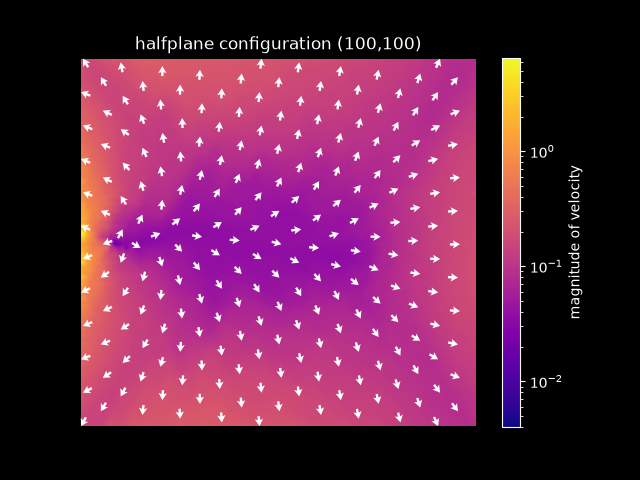
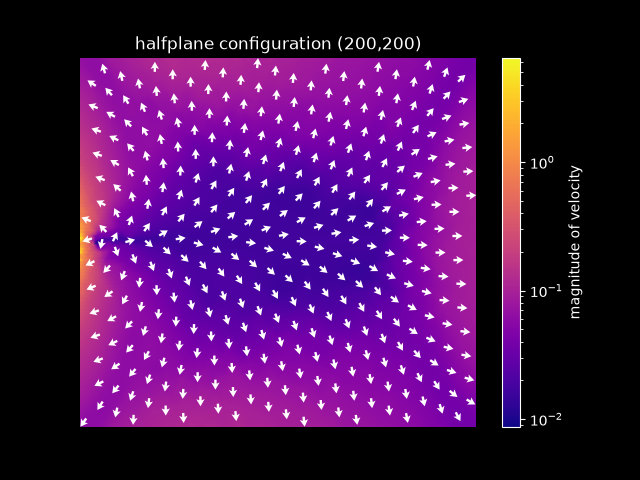

# wxml billiards

software used to simulate and visualize collisions in 'pinned' billiard ball systems

| results for 100x100 grid | results for 200x200 grid  |
| :---: | :---: |
|  |  |

## overview

the simulation software is written in c++ and is located in the `simulator` subdirectory. there are also unit tests (written with `catch2`) located next to the main simulation source files

the visualization software is located in the `visualization` subdirectory. it contains `python` code to parse and visualize the results of a simulation run stored in a custom binary format file.
<!-- the `python` dependencies are enumerated in the `requirements.txt` file -->

## requirements
- a modern c++ compiler
- `cmake`: to build the c++ simulation code
- `python`: to generate visualizations of the simulation results
- a linux or macos environment

> NOTE: all code was run/tested in a macos environment with c++23 as the compiler standard

## usage

the main executable produced by the c++ code runs a simulation with hardcoded grid dimensions (number of rows/columns) and writes the steady-state velocity distribution to a file in a directory provided as a command-line argument.

> NOTE: the output file is a custom binary format where the first two 64-bit unsigned integers are the number of rows and columns. the remaining data consists of pairs of 64-bit floating-point values representing the x- and y-components of the ball velocities in the system. the data is stored in big-endian layout

the c++ simulator code uses `cmake` as the build system. there are several `cmake` workflows available to easily invoke the desired build type; currently, we have `debug`, `release`, and `relwithdebinfo` build types with predefined workflows

the `debug` build has several c++ sanitizers enabled whereas the other build types do not. the `relwithdebinfo` build is useful for running with runtime profilers, since `release` builds do not contain debug symbols

> NOTE: please read the `cmake` docs on presets if you are not familiar with using them

### simulation

- list available workflow presets
```bash
$ cmake --workflow --list-presets
```

- build and run tests for a debug build:
```bash
$ cmake --workflow debug
```

- build and run the main executable for a release build:
```bash
$ cmake --workflow release-run
```

each build type also has a `-run` workflow which simply runs the main simulation executable with hardcoded parameters; change those parameters in `main.cpp` if desired
> NOTE: the main executable expects a runtime argument which is the output directory name. this argument MUST be provided to `cmake` at CONFIGURE-time. modify CMakePresets.json accordingly before invoking the workflow to change that runtime argument (RESULTS_DIRPATH)

### visualization

the `python` script is relatively straightforward; use `main.py -h` to discover its usage


### benchmarks

> NOTE: benchmark targets are only available for the `release` build type, since measuring performance for a `debug` build is generally not useful

<!-- - run all benchmarks -->
<!-- ```bash -->
<!-- $ cmake --build --preset release --target run-benchmarks -->
<!-- ``` -->

> NOTE: cmake does not support passing arguments to targets (at least for non-Make generators). so arguments passed to the catch2 executable (eg filter strings) must be provided in the build system directly.
> alternatively, a user can invoke the benchmark executable and pass arguments as usual, but this breaks the abstraction that cmake provides
```bash
$ ./build/release/simulator/test/benchmarks              \
    --reporter json::out=data/benchmarks/results.json    \
    --reporter console::out=-
```
